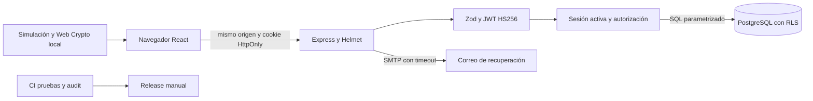
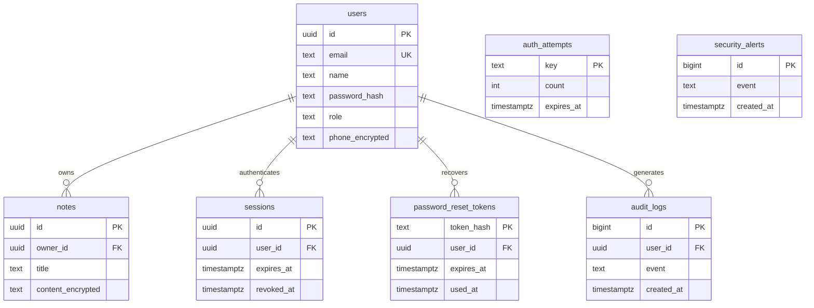

# Arquitectura y diccionario de datos

React presenta notas, perfil, administración y experimentos educativos. Express valida identidad, rol y propietario. PostgreSQL almacena hashes, cifrado y eventos. El modo vulnerable construye objetos ficticios en React y nunca apaga controles del servidor.

Local: Express sirve el build en localhost:3001; PostgreSQL 17.12 usa SCRAM y loopback:55432. El buzón SMTP no envía correos a Internet. Producción requiere HTTPS y Supabase con CA verificada; no está desplegada.

| Tabla | Campos y restricciones |
|---|---|
| users | UUID generado; email único normalizado; nombre 2-80; hash Argon2id; rol user/admin; teléfono cifrado opcional; created_at |
| notes | UUID; FK owner_id con CASCADE; título 1-100 legible; contenido 1-5000 cifrado; created_at/updated_at; índice de propietario |
| sessions | UUID nuevo por login; FK usuario; expires_at obligatorio de 15 min; revoked_at nullable |
| password_reset_tokens | SHA-256 hexadecimal PK; FK usuario; expires_at obligatorio de 15 min; used_at nullable |
| audit_logs | Identidad bigint; evento fijo sin payload; FK usuario nullable con SET NULL; created_at |
| auth_attempts | SHA-256 de IP/cuenta con prefijo; contador entero; expiración persistente |
| security_alerts | Identidad bigint; evento fijo; created_at |

Longitudes se validan en Zod; relaciones y roles también en SQL. El título, nombre y correo permanecen legibles: no incluir secretos en títulos. No hay job automático de retención: definirlo antes de producción, por ejemplo purgar sesiones/tokens expirados tras 30 días, ventanas de bloqueo diariamente y auditar 90 días según política institucional.

El migrador posee el esquema; el runtime no tiene superuser, BYPASSRLS, DDL ni eliminación de auditoría. RLS admite al rol confiable del backend y bloquea Data API. El aislamiento entre usuarios se implementa con WHERE owner_id en Express; no se atribuye a RLS un aislamiento entre usuarios que comparten el rol backend.
